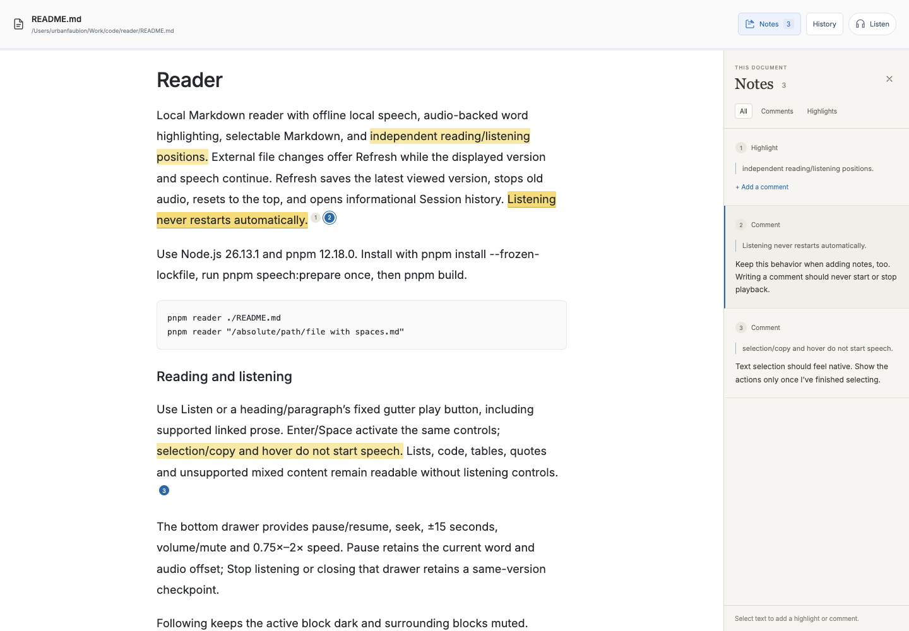
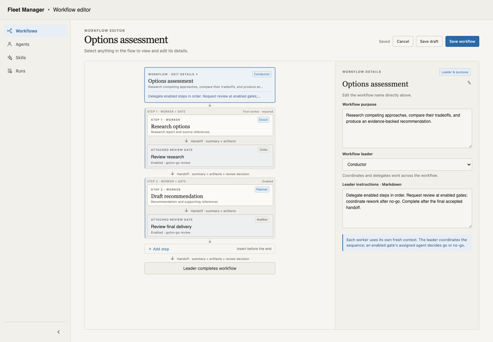
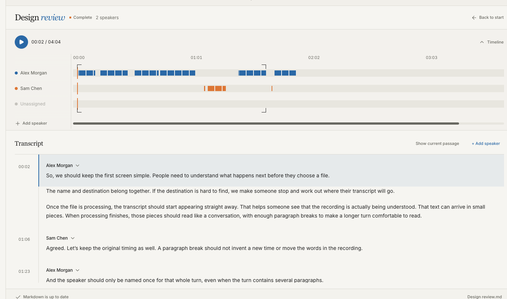
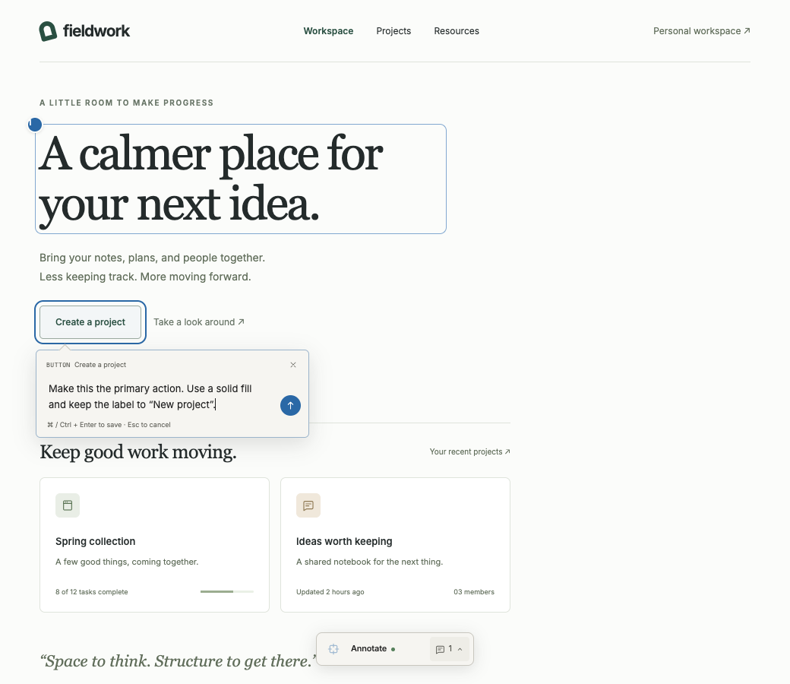
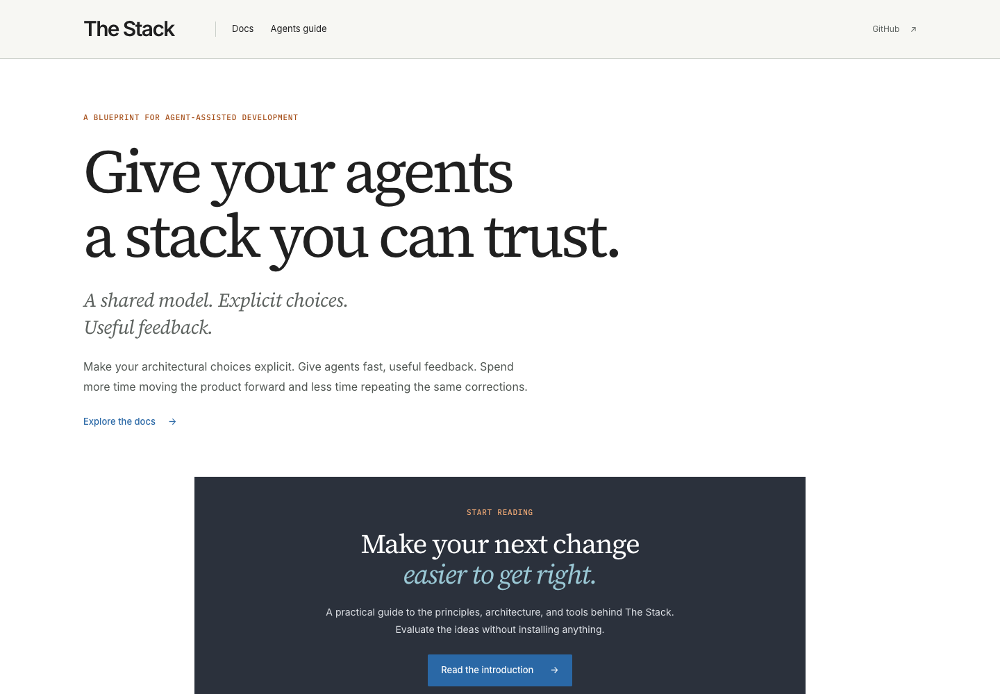

**Building tools around how I work**

This month, I’ve been building tools for reading, reviewing, capturing conversations, and working with AI agents. They’re separate projects, but a common question runs through them: how do I make the work easier to understand, direct, and check?

### Reader: Making room to read and listen

Reader opens local Markdown in a focused reading interface, with speech, word highlighting, and independent reading and listening positions. This month’s work added explicit refresh, viewed-version history, highlights, and comments.

I’m building it because producing documents is only part of the work. I also need a comfortable way to absorb them, move between reading and listening, and keep thoughts attached to the relevant passage.

_Design preview: highlighted passages and their notes stay together._

### Fleet Manager: Making agent workflows visible

Fleet Manager is taking shape as a place to define agents and reusable workflows. The design makes the sequence visible: who leads, who does each step, what gets handed over, and where review happens.

November’s work has focused on agent creation and workflow authoring, including configuration, save review, and recovery. Execution remains future work. I’m building toward a way to inspect and reuse a process without reconstructing it from a long conversation.

_Design preview: worker steps, review gates, and handoffs in a reusable workflow._

### Scribe: Keeping conversations useful afterward

Scribe is a desktop transcription project built around local audio, speaker-attributed transcripts, and playback tied to the text. The aim is to keep recordings and processing on the computer while making the resulting conversation easy to review.

This month’s work has included speaker review, recording pause and browsing behavior, and reusable template management. I’m interested in the path from a conversation to something useful afterward: a transcript I can check, then material I can work with again.

_Design preview: a speaker timeline alongside a transcript with audio playback._

### Annotate: Putting feedback where it belongs

Annotate supports reviewing Markdown and returning feedback to an agent. Browser annotation extends that idea to interfaces: select an element, write beside it, and deliberately send the collected feedback back to the original session.

November brought browser capture, saved drafts, submission, and resume work. The image shows a proposed next iteration with a small movable control and comments anchored to their targets. I’m building it to reduce the effort of explaining exactly which part of a document or interface needs attention.

_Proposed browser design: a comment beside its target and a compact movable control._

### The Stack: Writing down the approach

The Stack brings together my preferred principles, architecture, and tools for building applications with agents. Its current form is a documentation website, with guidance for people and an agent-readable overview.

I’m using it to make recurring decisions explicit: how capabilities fit together, who owns state and resources, and how checks provide useful feedback. These projects give me concrete places to test those ideas and refine the guidance.

_The Stack’s local website: a shared model, explicit choices, and useful feedback._

### What I’m learning

Much of the design work happens between the obvious actions. What happens when a file changes during playback? When feedback is saved but hasn’t been sent? When recording pauses but earlier text is still being reviewed? Those transitions increasingly shape both the interface and the architecture.

### Still to add

These are prompts for the next editing pass:

- **A personal opening:** one real moment that captures what this month felt like.
- **One concrete use:** something I read, recorded, or reviewed with these tools.
- **One changed opinion:** a design or technical approach I revised, and why.
- **Reading and influences:** two or three things that affected my thinking.
- **A December question:** which tool I most want to use in everyday work, and what still stands in the way.
